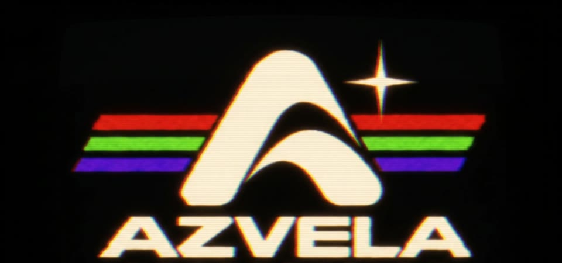
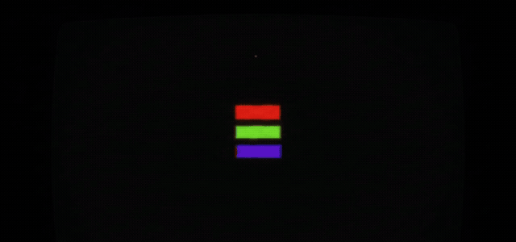

# Origin / 001

**A Future Worth Feeling.**

The Azvela origin film is a ten-second visual signature. It brings the warmth of analog technology into a vision of the future: red, green and violet, a sculpted A, a small star and an unmistakably human sense of wonder.

[Watch or download the original film (MP4, 10 seconds)](https://raw.githubusercontent.com/Azvelahq/.github/main/assets/brand/azvela-origin-film.mp4) · [View the file on GitHub](https://github.com/Azvelahq/.github/blob/main/assets/brand/azvela-origin-film.mp4)

The original contains sound, CRT-style distortion and brief visual glitches. Playback is optional. The static image and visual description convey the identity without requiring motion or audio.

Reveal a short, silent motion preview (4.6 seconds)

## Visual description

| Time (approx.) | Image |
| --- | --- |
| 0–1 s | A dark, softly textured screen. Three horizontal bands emerge. |
| 1–3 s | The bands become red, green and violet; the cream-colored A is revealed in front of them. |
| 3–6 s | The AZVELA lettering assembles and the original film reveals a secondary line of text. |
| 6–10 s | A four-point star appears; the emblem settles with brief analog distortion. |

## A note on identity

The three colors represent our creative vocabulary. The original film is a brand concept; its artwork is not evidence of incorporation, trademark registration, product availability or certification. The poster is a cropped still from the film. The short preview is a silent excerpt, not a replacement for the original.

Our public introduction remains readable without media. [Return to the organization profile](https://github.com/Azvelahq) or read our [engineering principles](PRINCIPLES.md).
