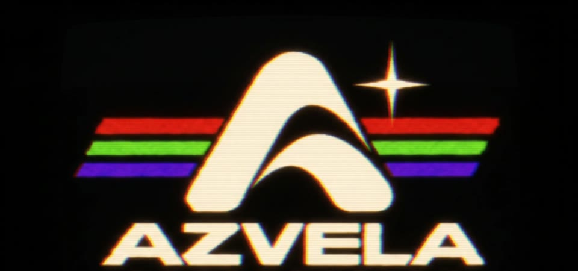

  
  <h1>A Future Worth Feeling.</h1>
  
<strong>Technology for a world that feels more human.</strong>

  
We are Azvela. An independent technology company in the making, exploring the future of human connection, creative expression and intelligent systems.

  
<a href="https://github.com/Azvelahq/.github/blob/main/docs/ORIGIN.md">Experience our origin film</a> · <a href="https://github.com/Azvelahq/.github/blob/main/docs/PRINCIPLES.md">How we build</a> · <a href="https://github.com/Azvelahq/.github/blob/main/docs/RESEARCH_PRINCIPLES.md">Our research</a>

---

## The future should feel like yours.

Somewhere between the things we make and the people we meet, technology can become something deeply personal. It should give us more room to imagine, more freedom to express ourselves and more ways to belong.

That is the future we want to build. Not one that demands more of your attention, but one that gives you more reasons to care.

## Three worlds. One belief.

| World | What we are exploring |
| :--- | :--- |
| **Pandly** | A place for imagination, communities and the identities we choose to create. |
| **Kyubi** | A more personal way to discover people, find common ground and belong. |
| **Crownchill** | Where play, friendship and self-expression meet. |

These are product directions in development, not announcements of public availability.

## The work behind the wonder.

We are exploring the systems that make ambitious experiences possible: distributed computing, privacy-preserving infrastructure, artificial intelligence, efficient runtimes and human-computer interaction.

The question is not just what technology can do. It is what it makes possible for people — and whether the evidence supports our claims.

[Engineering principles](https://github.com/Azvelahq/.github/blob/main/docs/PRINCIPLES.md) · [Research integrity](https://github.com/Azvelahq/.github/blob/main/docs/RESEARCH_PRINCIPLES.md) · [Responsible AI](https://github.com/Azvelahq/.github/blob/main/docs/RESPONSIBLE_AI.md)

## What we refuse to compromise.

**People first.** Design for agency, accessibility and meaningful connection.  
**Privacy by design.** Earn trust through deliberate choices, not promises alone.  
**Creative freedom.** Make room for individuality without coercion.  
**Evidence before claims.** Let the work withstand scrutiny.

## Make something that matters.

Curiosity is welcome here. Explore our [public repositories](https://github.com/orgs/Azvelahq/repositories), read our [contribution guide](https://github.com/Azvelahq/.github/blob/main/CONTRIBUTING.md), or learn about our [approach to trust](https://github.com/Azvelahq/.github/blob/main/docs/TRUST.md).

[Security reporting](https://github.com/Azvelahq/.github/blob/main/SECURITY.md) · [Support](https://github.com/Azvelahq/.github/blob/main/SUPPORT.md) · [En español](https://github.com/Azvelahq/.github/blob/main/docs/ES.md)

---

  <strong>Imagine more. Build with care.</strong> 
  AZVELA · An idea becoming reality.

